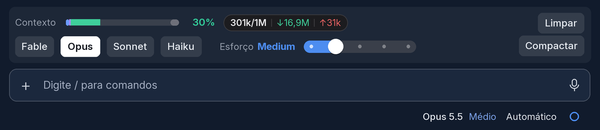
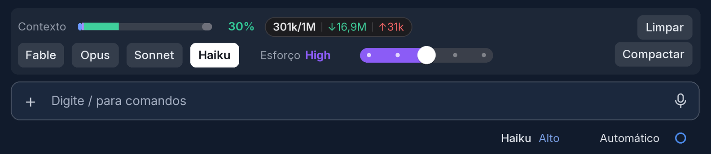

# Seletor de Modelo (mod do Claude Code)

Faixa acima da caixa de mensagem do Claude Code com tudo o que se mexe durante a conversa.



Trocando para o Haiku e subindo o esforço para High (a trilha muda de cor com o nível):



## Instalar

No Claude Code do terminal, digite:

```
/plugin install seletor-modelo --marketplace edirsooo/seletor-modelo
```

Responda `y` para adicionar o marketplace e confirme com Enter. A faixa aparece na hora.

Pelo terminal do sistema (PowerShell, Terminal):

```
claude plugin install seletor-modelo --marketplace edirsooo/seletor-modelo
```

No app do Claude (aba Code), onde `/plugin` não roda: clique no **+** ao lado da caixa de mensagem → **Plugins** → **Add marketplace** com `edirsooo/seletor-modelo` → **Add plugin**.

## O que tem na faixa

- **Contexto**: barra arredondada colorida (instruções, ferramentas, conversa e reserva) com a porcentagem usada.
- **Painel de tokens**: uso da janela (ex.: `215k/1M`), **↓** entrada em verde e **↑** saída em vermelho.
- **Modelos**: Fable, Opus, Sonnet e Haiku (do mais forte ao mais leve). Rodam `/model` de verdade, e a barra de baixo do app acompanha.
- **Esforço**: o nível aparece ao lado do nome (ex.: **Esforço Medium**) e a trilha vem depois. Segure a bolinha e arraste, ou clique num ponto da trilha (Low, Medium, High, X-High, Max). Um pontinho marca cada nível e a cor muda com ele: verde, azul, roxo, âmbar e vermelho. Roda `/effort`.
- **Ultra** (chavinha ao lado do esforço): liga e desliga o Ultracode. Ligada (roxa), cada pedido digitado sai com a palavra `ultracode` no fim, o que libera o trabalho com vários agentes (gasta bem mais). Comandos com `/` não mudam. Começa desligada em cada sessão.
- 🗑️ **Limpar** (texto avermelhado): começa a conversa do zero (`/clear`). Apaga na hora, sem confirmação.
- 🎯 **Meta** (texto esverdeado): escreve `/goal ` na caixa de mensagem; é só digitar a meta e dar Enter para o Claude trabalhar sem parar até cumpri-la.
- 🗂️ **Compactar** (texto amarelado): resume a conversa para liberar contexto (`/compact`).

A faixa fica em três blocos alinhados: contexto em cima dos modelos, tokens em cima do esforço, e as ações à direita (Limpar em cima, Meta e Compactar embaixo).

Entrada e saída são somadas a partir da primeira resposta depois da instalação e zeram no Limpar.
Se a conta não tiver acesso a algum modelo, o app avisa ao clicar.

## Desinstalar

```
/plugin uninstall seletor-modelo
```
